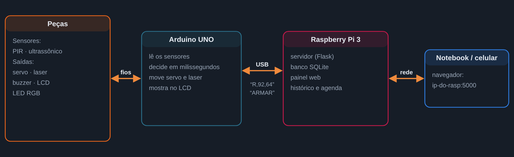
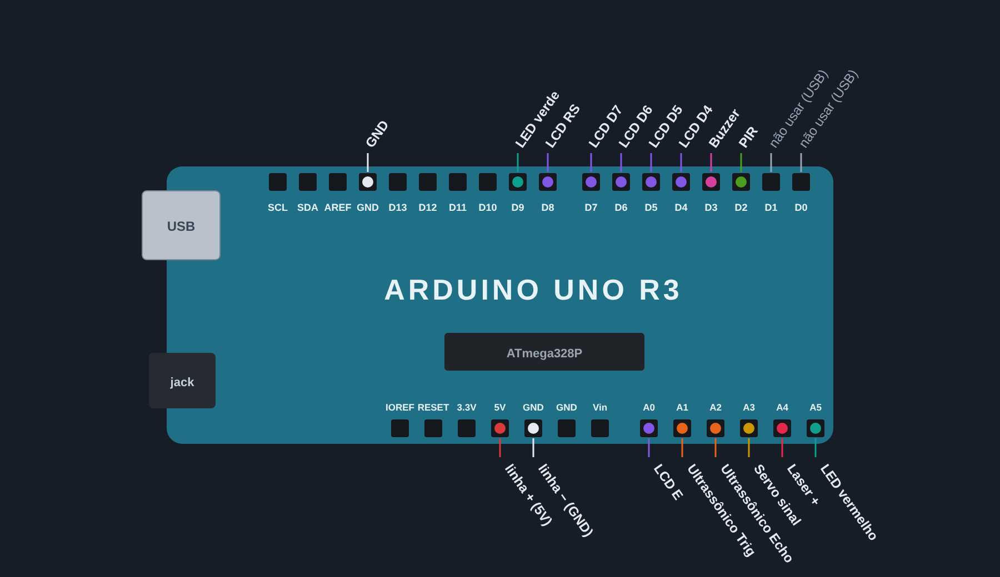
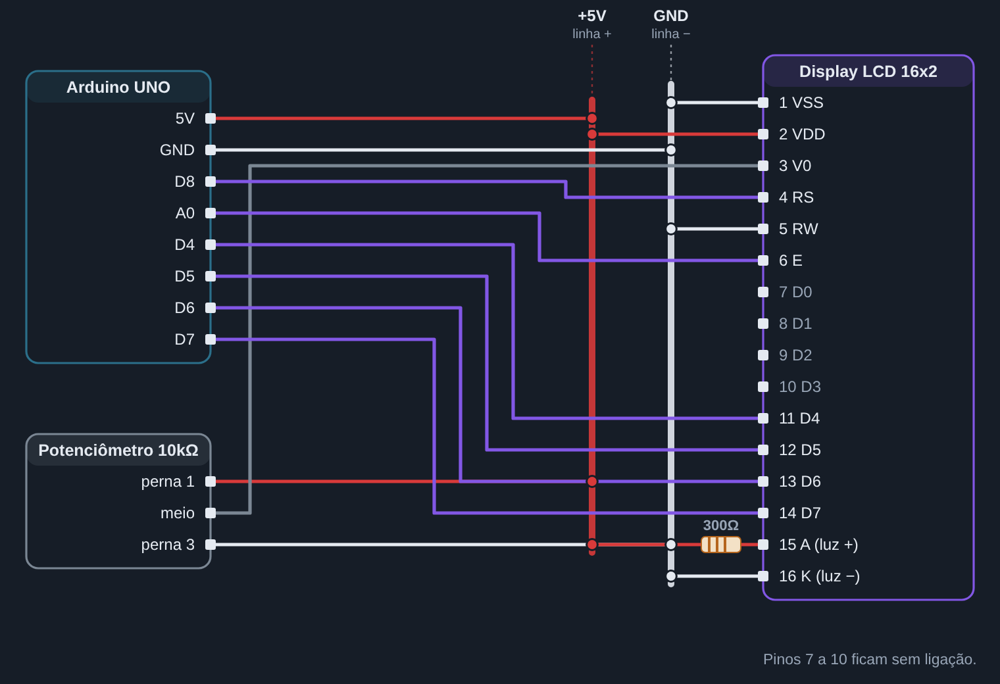
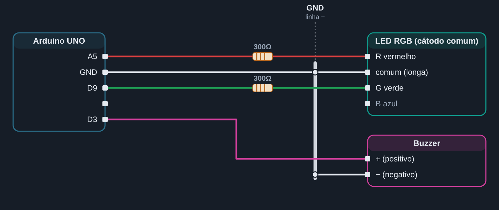
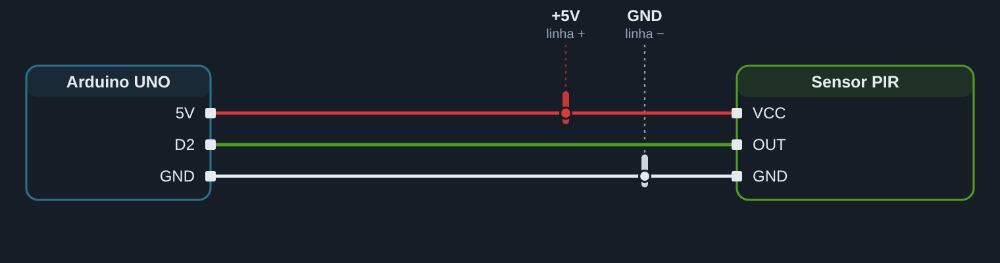
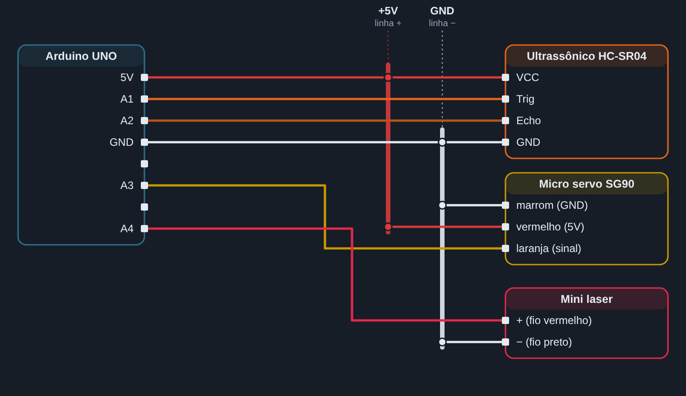
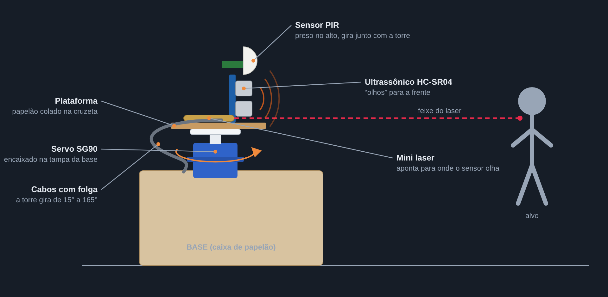
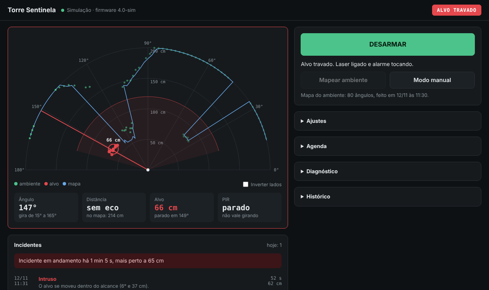

# Torre Sentinela

Projeto de Laboratório de Desenvolvimento com Arduino e Raspberry Pi.

A Torre Sentinela é um radar de segurança feito com o Master Kit da RoboCore. Um servo gira o sensor ultrassônico e o sensor PIR; quando a torre encontra algo que não faz parte do ambiente, ela confere, trava no alvo, acende o laser e dispara o alarme. O Raspberry Pi funciona como servidor: recebe as leituras do Arduino pela USB, guarda o histórico e mostra um painel web que pode ser aberto no notebook ou no celular.

## Integrantes

- Aline Camargo
- Ana Júlia Rubim
- Enrico Germano
- Leonardo da Silva
- Lucas Marins
- Rafael Sette
- Vinícius Leite

## Como funciona



- O **Arduino** cuida do tempo real: lê os sensores, move o servo, liga o laser e o buzzer e mostra o estado no LCD.
- O **Raspberry Pi** roda um servidor em Python (Flask). Ele recebe cada leitura pela serial, salva eventos e incidentes num banco SQLite e manda os comandos do painel para o Arduino.
- O **painel web** mostra o radar ao vivo, os incidentes e as configurações da torre.

### Detecção

1. Ao armar, a torre espera 5 segundos e faz cinco varreduras para mapear o ambiente (paredes e móveis).
2. Depois ela fica varrendo e comparando cada leitura com o mapa. Quando uma leitura vem mais perto que o mapa, ela repete a medida na hora; se a segunda bater, para ali para verificar.
3. Na verificação a torre faz uma varredura curta em volta do ponto. Um objeto de verdade aparece em vários ângulos seguidos, um eco falso aparece em um só. Só o primeiro caso vira alarme.
4. Com o alvo travado, a varredura curta continua e acompanha o alvo. Se ele sumir, a torre procura numa área maior antes de desistir.
5. Um alvo que fica 20 segundos parado no mesmo lugar é conferido com o PIR: a torre para apontada para ele e, se o PIR não acusar movimento, o objeto entra no mapa e o alarme para.
6. O PIR fica na parte que gira, então a leitura dele só vale com a torre parada.
7. O buzzer só toca entre uma leitura e outra do ultrassônico, para o som não atrapalhar a medida.

### Estados

| Estado | LED | O que faz |
|---|---|---|
| DESARMADO | verde | Parada. Continua lendo o sensor para dar para testar pelo painel |
| ARMANDO | amarelo piscando | 5 s para sair da área |
| CALIBRANDO | amarelo piscando rápido | Mapeia o ambiente |
| VIGIANDO | amarelo | Só com a varredura contínua desligada: para em 3 posições e espera o PIR |
| VARRENDO | vermelho/amarelo | Varre de 15° a 165° comparando com o mapa |
| TRAVADO | amarelo piscando, depois vermelho | Verifica e, se confirmar, liga o laser e o alarme; sirene quando chega perto |
| MANUAL | verde piscando | Mira e laser controlados pelo painel |

## Componentes

- Arduino UNO R3
- Raspberry Pi 3
- Sensor ultrassônico HC-SR04
- Sensor de presença PIR (HC-SR501)
- Micro servo SG90
- Mini laser
- Display LCD 16x2 e potenciômetro de 10 kΩ (contraste)
- LED RGB, buzzer e 3 resistores de 300 Ω
- Protoboard e jumpers

## Ligações

| Pino | Ligação |
|---|---|
| D2 | PIR (OUT) |
| D3 | Buzzer (+) |
| D4 a D7 | LCD D4 a D7 |
| D8 | LCD RS |
| D9 | LED RGB verde (com resistor de 300 Ω) |
| D10 | Botão opcional para armar/desarmar (outra perna no GND) |
| A0 | LCD E |
| A1 | HC-SR04 Trig |
| A2 | HC-SR04 Echo |
| A3 | Servo (fio laranja) |
| A4 | Laser (+) |
| A5 | LED RGB vermelho (com resistor de 300 Ω) |
| 5V / GND | Linhas + e − da protoboard |



| | |
|---|---|
|  |  |
|  |  |

### Montagem da torre



Antes de colar a cruzeta no servo, grave o código: ao ligar, o servo vai para a posição central (90°) e a cruzeta deve ser encaixada apontando para a frente. No PIR, deixamos o ajuste de tempo no mínimo, a sensibilidade no meio e o jumper na posição H.

## Como rodar

### Arduino

1. Abra `arduino/torre_sentinela/torre_sentinela.ino` na Arduino IDE 2. As bibliotecas usadas (Servo, LiquidCrystal e EEPROM) já vêm com a IDE.
2. Selecione a placa **Arduino Uno** e a porta, e carregue o código.
3. A versão aparece no LCD com a torre desarmada. No Monitor Serial (115200 baud) deve aparecer `OI,TorreSentinela,4.0`. O comando `STATUS` responde com o estado e a configuração.
4. Depois de testar, ligue o Arduino na USB do Raspberry Pi.

### Raspberry Pi

Com o Raspberry Pi OS instalado e o SSH ativo, copie a pasta do projeto e rode o instalador:

```
scp -r torre-sentinela pi@<ip-do-rasp>:~
ssh pi@<ip-do-rasp>
cd ~/torre-sentinela/rasp
bash instalar.sh
```

O instalador cria o ambiente Python, instala as dependências e deixa o servidor iniciando junto com o Raspberry. No fim ele mostra o endereço do painel, que fica em `http://<ip-do-rasp>:5000`.

Comandos úteis:

```
journalctl -u torre -f          # ver os logs
sudo systemctl restart torre    # reiniciar o servidor
```

### Testar sem o Arduino

O `simulador.py` imita o Arduino com um ambiente de teste (paredes, um móvel, uma pessoa que entra de tempos em tempos):

```
cd rasp
pip install flask pyserial
python3 servidor.py --simular
```

E abra `http://localhost:5000`.

## Painel



No painel dá para armar e desarmar, ver o radar com o mapa do ambiente, controlar a mira e o laser no modo manual, ajustar o alcance, a área de varredura e a tolerância ao mapa, programar horários para armar e desarmar e ver os incidentes. Cada incidente é classificado como intruso, objeto parado, movimento fora do alcance ou indefinido.

A parte de diagnóstico mostra a versão do firmware, a porcentagem de leituras do ultrassônico que voltam sem eco, o estado do PIR e quantas vezes o Arduino reiniciou sozinho. Isso ajuda a separar problema de fio ou de alimentação de problema de código.

## Estrutura

```
torre-sentinela/
├── arduino/torre_sentinela/torre_sentinela.ino   código do Arduino
├── rasp/
│   ├── servidor.py         servidor Flask + SQLite
│   ├── simulador.py        simula o Arduino para testes
│   ├── static/index.html   painel web
│   ├── instalar.sh         instalação no Raspberry Pi
│   ├── torre.service       serviço do systemd
│   ├── config.env.exemplo  configurações opcionais
│   └── requirements.txt
├── docs/img/               esquemas e imagens
└── apresentacao/           slides da apresentação
```

## Apresentação

Os slides estão em [apresentacao/Torre_Sentinela.pptx](apresentacao/Torre_Sentinela.pptx).
